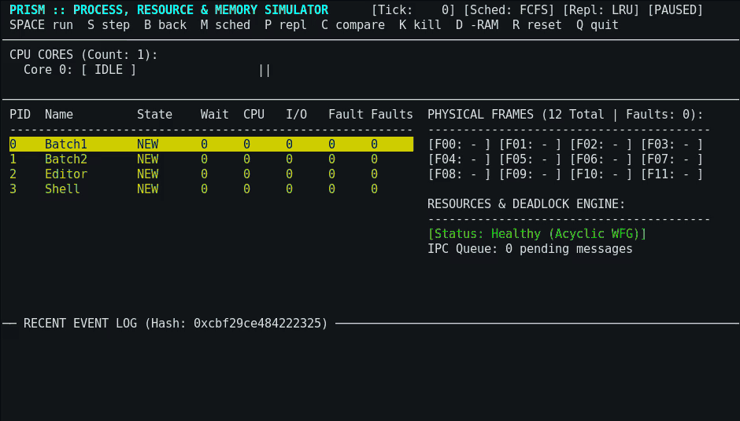
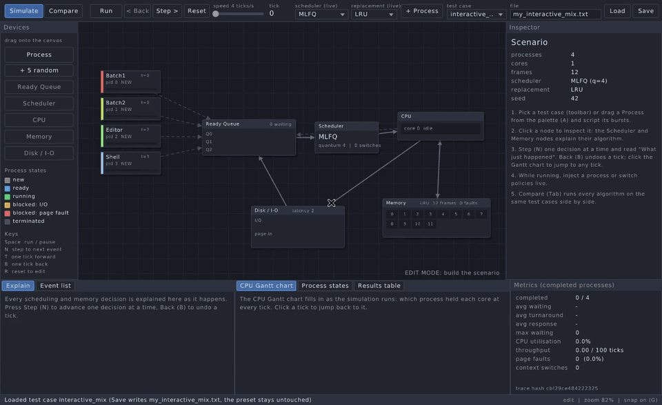
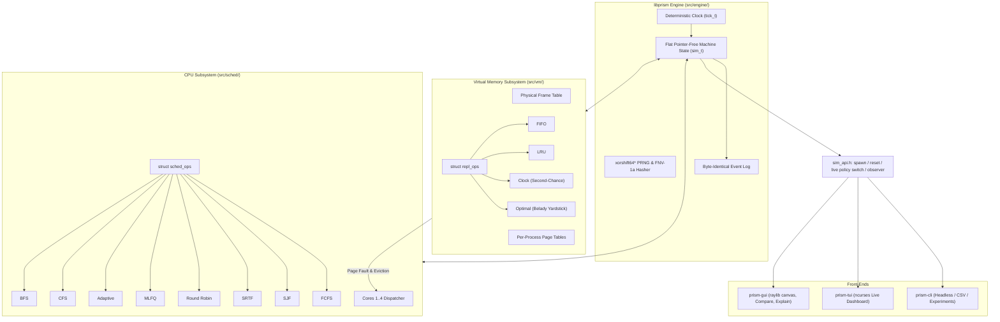
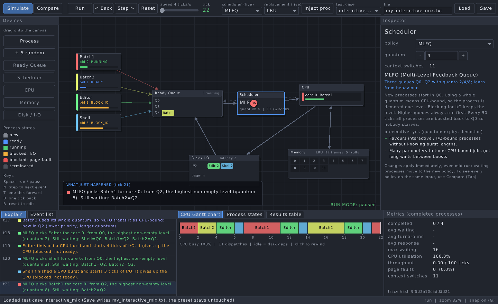
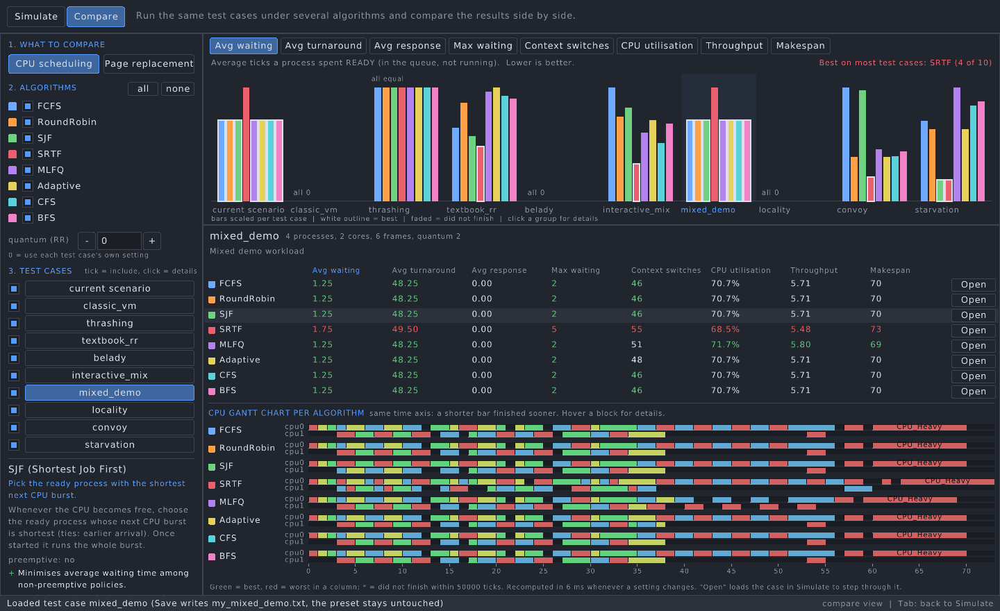
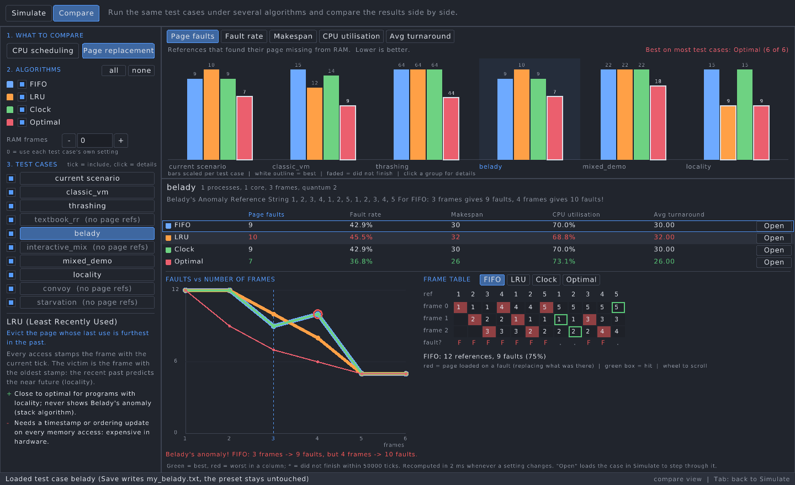
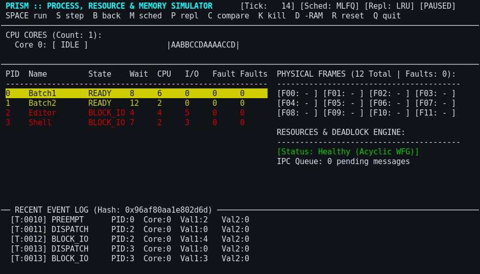
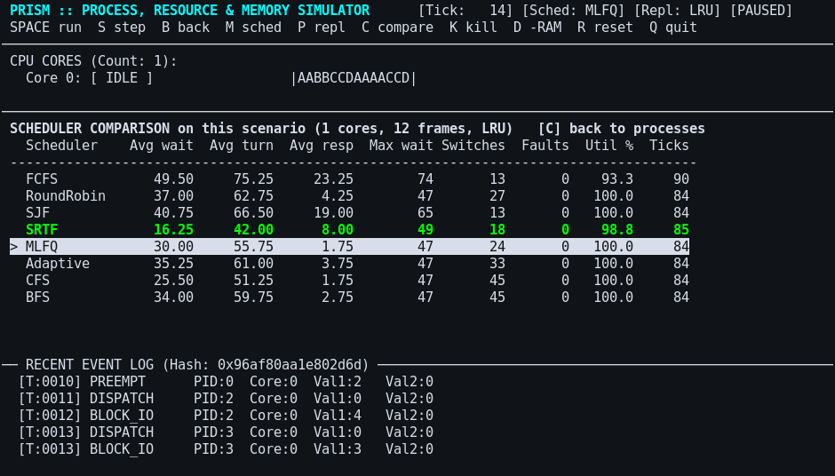

# PRISM: Process, Resource & Interprocess Simulation Model

A deterministic operating-system simulator in pure C11: 8 CPU schedulers, 4 page-replacement policies, an ncurses dashboard and a raylib GUI. PRISM models the interaction between **CPU scheduling** and **virtual memory**: a page fault blocks a process, which changes what the scheduler does next.



*`prism-tui` on `workloads/interactive_mix.txt`: the run starts under FCFS (one long block in the Gantt strip), then the scheduler is switched live to CFS and the processes start interleaving.*



*`prism-gui`: processes travel between the ready queue, CPU and disk while every scheduling decision is explained.*

---

## Key Highlights & Architectural Decisions

1. **Flat, Pointer-Free State (`sim_t`)**:
   - The entire simulation machine state lives in a single, contiguous struct with fixed-capacity arrays.
   - Ready queues and page tables use 16-bit indices instead of pointers.
   - **Snapshot & Rewind**: Taking a snapshot of the entire machine is a single `memcpy` (`sim_snapshot`), enabling interactive rewind and replay during demos.

2. **Guaranteed Determinism**:
   - Uses an internal 64-bit `xorshift64*` PRNG rather than `rand()` from host libc.
   - Produces byte-identical event logs verified via 64-bit **FNV-1a log hashing**.
   - `Same workload + same seed + same policies = byte-identical event log hash`.

3. **Pluggable Policy Ops Tables**:
   - **Schedulers (`sched_ops_t`)**: 8 deterministic policies supported:
     - `FCFS`: First-Come First-Served.
     - `SJF`: Shortest Job First (non-preemptive).
     - `SRTF`: Shortest Remaining Time First (preemptive on arrival and wake).
     - `Round Robin`: Quantum-based timeslicing.
     - `MLFQ`: 3-level Multi-Level Feedback Queue with priority boosting.
     - `Adaptive`: Starvation aging + page-fault thrashing awareness.
     - `CFS`: a simplified Completely Fair Scheduler: per-process virtual runtime (`vruntime`) weighted by priority, 2-tick slices, and waking processes placed at `min_vruntime` with one slice of credit.
     - `BFS`: a simplified Brainfuck Scheduler: single run queue, earliest virtual deadline first (`virtual_deadline`), deadline pushed out by priority.
   - CFS and BFS model the selection rule of their Linux namesakes, not the kernel implementations (no red-black tree, no per-CPU queues). With equal priorities BFS behaves like Round Robin with a 2-tick quantum.
   - **Page Replacement (`repl_ops_t`)**: FIFO, LRU, Clock (second chance), and Optimal (Belady's OPT). Switchable at runtime.

4. **The Integration Loop**:
   - CPU burst accesses virtual page $\to$ page fault blocks process $\to$ disk services after $N$ ticks $\to$ frame allocated/evicted $\to$ process restored to `READY`.

5. **Frontends**:
   - `libprism.a`: Standalone C library with zero I/O or GUI dependencies.
   - `prism-cli`: Headless batch experiment runner, text Gantt chart generator, and CSV exporter.
   - `prism-tui`: Interactive `htop`-style ncurses dashboard with live frame allocation grid, fault injection, rewind and a side-by-side scheduler comparison.
   - `prism-gui`: raylib "Packet Tracer for processes" (see below).

---

## Architecture Diagram



---

## Directory Layout

```
.
├── Makefile                     # Release, ASan/UBSan, valgrind, gui targets
├── include/prism/
│   ├── types.h  pcb.h  sim.h    # Flat sim_t machine state, PCB, events, limits
│   ├── prng.h   hash.h          # xorshift64* generator, FNV-1a trace hash
│   ├── sched.h  vm.h            # sched_ops_t / repl_ops_t policy interfaces
│   ├── sim_api.h                # Interactive API used by every frontend
│   ├── scenario.h               # Scenario save/load (workload + GUI layout)
│   ├── metrics.h                # Metrics and same-seed algorithm comparison
│   └── workload.h               # Workload parser and generators
├── src/
│   ├── engine/                  # sim.c (tick loop), sim_api.c, scenario.c, metrics.c, workload.c
│   ├── sched/schedulers.c       # FCFS, RR, SJF, SRTF, MLFQ, Adaptive, CFS, BFS
│   ├── vm/replacement.c         # FIFO, LRU, Clock, Optimal
│   ├── cli/main.c               # prism-cli
│   └── ui/tui.c                 # prism-tui
├── gui/                         # prism-gui (raylib): canvas, animation, explain, Gantt, compare
├── tests/                       # test_prism.c, test_api.c, test_metrics.c (+ test_harness.h)
└── workloads/                   # 9 scenarios, each with a comment on what to look for
```

---

## Quickstart & Build Targets

Needs a C11 compiler and `make`. `prism-tui` needs ncurses; `prism-gui` needs raylib 5.x. The core library and `prism-cli` need only libc and libm.

```bash
make              # build/libprism.a, prism-cli, prism-tui  (-O2 -Wall -Wextra -Wpedantic, warning-free)
make test         # build and run every tests/test_*.c
make sanitize     # clean rebuild + tests under AddressSanitizer and UBSan (leak check on)
make valgrind     # tests under valgrind (needs glibc debug symbols installed)
make gui          # prism-gui
make experiments  # ./prism-cli --all-exp
./prism-cli --help
```

### Test output

`make test` runs 28 tests in three suites:

```
=== Running Test Suite: PRISM Interactive API (sim_api / scenario) ===
  [RUN]  proc_spec validation rejects bad scripts ... PASS
  [RUN]  Spawn process mid-run arrives now and completes ... PASS
  [RUN]  Reset then rerun reproduces metrics and trace hash ... PASS
  [RUN]  Remove: only NEW/TERMINATED, pids never reused ... PASS
  [RUN]  Update: allowed before first run only ... PASS
  [RUN]  Observer sees every event in trace order; no effect on hash ... PASS
  [RUN]  step_event advances to the next notable event ... PASS
  [RUN]  Live scheduler switch keeps every ready process; names resolve ... PASS
  [RUN]  set_frames validates, resets, and changes fault counts ... PASS
  [RUN]  set_cores resets; set_disk_latency applies live ... PASS
  [RUN]  Scenario save/load round-trips script, config and layout ... PASS
  [RUN]  Old workload files load via scenario_load (Belady still 9 faults) ... PASS
All 12 tests passed successfully!

=== Running Test Suite: Metrics & algorithm comparison ===
  [RUN]  textbook RR workload: average waiting time per scheduler ... PASS
  [RUN]  metrics: turnaround, response, utilisation, throughput ... PASS
  [RUN]  classic reference string: FIFO 15, LRU 12, OPT 9 faults (3 frames) ... PASS
  [RUN]  frame override shows Belady's anomaly (FIFO 3 -> 9, 4 -> 10) ... PASS
  [RUN]  variant from a mid-run base = variant from a fresh base; base untouched ... PASS
  [RUN]  sim_run_bounded stops after max_ticks ... PASS
All 6 tests passed successfully!

=== Running Test Suite: PRISM Core, Scheduling & VM Suite ===
  [RUN]  Log Determinism & FNV-1a Hash Invariance ... PASS
  [RUN]  Flat State Memcpy Snapshot & Rewind Verification ... PASS
  [RUN]  Textbook Classic Page Replacement (FIFO=15, LRU=12, OPT=9) ... PASS
  [RUN]  Belady's Anomaly (FIFO 3 frames = 9 faults, 4 frames = 10 faults) ... PASS
  [RUN]  Fault Injection: Process Termination & Dynamic RAM Shrink ... PASS
  [RUN]  Textbook SJF and SRTF Scheduling Verification ... PASS
  [RUN]  CFS and BFS Schedulers Invariance & Fairness ... PASS
  [RUN]  CFS: CPU share follows weight; a waking sleeper is not sent to the back ... PASS
  [RUN]  Resource Manager, WFG Cycle Detection & Checkpoint Rollback ... PASS
  [RUN]  IPC Message Queue Producer-Consumer Synchronization ... PASS
All 10 tests passed successfully!
```

The same 28 tests pass under `make sanitize` with no ASan, UBSan or leak reports.

---

## Experiments

### Experiment 1: Scheduler comparison on a mixed workload
Six processes (CPU-bound, interactive, I/O-bound) under all 8 schedulers, same seed:
```bash
./prism-cli --exp1
```
```
Scheduler    Avg Wait   Avg Turn   Avg Resp   Ctx Switches CPU Util %
----------------------------------------------------------------------
FCFS         64.50      119.50     1.67       88           98.1     %
SJF          28.00      62.50      9.50       47           95.8     %
SRTF         27.83      61.33      10.17      51           93.3     %
Round Robin  68.50      125.50     1.67       112          99.4     %
MLFQ         58.67      104.17     1.67       81           99.3     %
Adaptive     69.50      124.50     1.67       103          96.9     %
CFS          55.17      97.17      2.00       83           98.5     %
BFS          68.50      125.50     1.67       112          99.4     %
```
SJF and SRTF minimise waiting time at the cost of response time. BFS equals Round Robin here because every process has the same priority.

### Experiment 2: Replacement policy vs. frame count, and Belady's anomaly
FIFO, LRU, Clock and Optimal on Belady's reference string `[1, 2, 3, 4, 1, 2, 5, 1, 2, 3, 4, 5]` and the classic 20-reference string:
```bash
./prism-cli --exp2
```
```
Frames   FIFO       LRU        Clock      OPT
3        9          10         9          7
4        10         8          10         6          <-- Belady Anomaly! (FIFO 3f=9 vs 4f=10)
5        5          5          5          5

Classic reference string (3 frames): FIFO=15 | LRU=12 | Clock=14 | OPT=9
```

### Experiment 3: Shrinking RAM and thrashing
Four processes with a combined working set of 12 pages, run with 12, 6 and 3 frames:
```bash
./prism-cli --exp3
```
```
Frames     Policy       CPU Util     Total Faults Total Ticks
12         RoundRobin   95.7       % 12           138
12         Adaptive     95.7       % 12           138
6          RoundRobin   88.7       % 100          248
6          Adaptive     88.7       % 100          248
3          RoundRobin   88.7       % 100          248
3          Adaptive     88.7       % 100          248
```
With 12 frames there are only the 12 cold faults. Once the working set no longer fits, every one of the 100 references faults and the run takes 248 ticks instead of 138. The Adaptive scheduler does **not** help on this workload: all four processes thrash equally, so demoting the thrashing ones changes nothing.

### Rewind and determinism
```bash
./prism-cli --rewind-demo
```
Snapshots the machine at tick 15, runs to completion, restores the snapshot, runs again, and checks that both runs end with the same FNV-1a trace hash.

Other demos: `--compare-sched`, `--compare-vm`, `--deadlock-demo` (wait-for-graph cycle detection and checkpoint rollback), `--all-exp`.

A flag given on the command line overrides the matching line of the workload file:
```bash
./prism-cli --workload workloads/interactive_mix.txt --sched cfs --repl clock --csv
```

---

## Interactive API & Scenario Files

Frontends drive the simulator through `include/prism/sim_api.h` rather than editing `sim_t` directly:

- `sim_spawn_process()` builds a process from a `proc_spec_t` (bursts + page references). Called mid-run, the process **arrives now**.
- `sim_remove_process()` / `sim_update_process()`, `sim_reset()` (rewind to tick 0, keep the scenario).
- `sim_set_sched()` / `sim_set_repl()` switch policies live; `sim_set_frames()` resets.
- `sim_step_event()` advances to the next notable event; `sim_set_observer()` streams every trace event to the UI.

Scenario files use the workload format plus optional `priority=` keys and GUI layout lines. Older tools ignore both, so a saved scenario still runs in `prism-cli`:

```
sched rr
quantum 4
proc Editor arrival=0 priority=1 bursts=C8,I3,C4 pages=loop:0:5:2
layout node=cpu x=640 y=200
```

The GUI design is in `GUI_PLAN.md`.

## Graphical Simulator (`prism-gui`)



A "Packet Tracer for processes": build an OS scenario on a canvas, then run it and watch processes move through the system.

- **Build:** drag *Process*, *Ready Queue*, *Scheduler*, *CPU*, *Memory* and *Disk / I-O* from the palette. The Process Builder scripts each process: name, arrival, priority, CPU/I-O bursts and page references. It also has templates (CPU-bound, I/O-bound, interactive, memory hog) and a seeded Random option.
- **Run:** Run/Pause (Space), Step to the next event (N), single tick (T), **Back one tick (B)**, speed slider, Reset (R). Each transition becomes a token travelling along the links. Memory frames flash on load (green) and eviction (red). Clicking the Gantt chart or the state timeline jumps to that tick (the run is deterministic, so rewinding = replaying from 0).
- **Explain:** every decision is narrated as it happens, with the reason the algorithm used: "SJF picks P2 for core 0: shortest next CPU burst (4 ticks). Still waiting: P3=9, P4=5", "RAM is full. LRU evicts page 3 of P1 from frame 2: it is the least recently used (last use t12)". The newest sentences also appear over the canvas. The Scheduler and Memory inspectors show a card for the current algorithm (rule, preemptive or not, strengths, weaknesses).
- **Interact while running:** inject a new process (it arrives *now*), switch the scheduler or replacement policy live, change disk latency.
- **Inspect:** click any node for its PCB, burst progress, page table, queues, frame table and controls.
- **Panels:** Explain / Event list on the left; textbook CPU Gantt chart, per-process state timeline and the **results table** (arrival, CPU, start, finish, turnaround, waiting, response, faults, with averages) in the middle; live metrics with a thrashing flag and the trace hash on the right.
- **Files:** Save/Load (Ctrl+S / Ctrl+O), test cases from `workloads/`, or drag a file onto the window. Scenario files include the node layout and still run in `prism-cli`. Loading a bundled test case points Save at `my_<name>.txt`, so the presets are never overwritten.

### Compare view (Tab)



Runs the same test cases under several algorithms and puts the results side by side. Every run is a fresh copy of the test case with the same seed (`sim_prepare_variant`), so only the algorithm differs.

- **CPU scheduling:** pick any of the 8 schedulers and any test cases (the current scenario plus every `workloads/*.txt`). Optional quantum override. A grouped bar chart shows one metric (avg waiting / turnaround / response, max waiting, context switches, CPU utilisation, throughput, makespan) over all test cases and names the algorithm that wins most often. The focused test case gets a full table (best value green, worst red) and **one Gantt chart per algorithm on a shared time axis**.
- **Page replacement:** FIFO / LRU / Clock / OPT with an optional frame-count override. Shows **faults vs number of frames** for each policy (Belady's anomaly is detected and called out) and the **textbook frame table**: frame contents after every reference, faults marked F, the loaded frame in red, hits boxed in green.
- **Open** on any row loads that test case in the Simulate view with that algorithm, ready to step through.



Bundled test cases, each with a comment saying what to look for (shown in the Compare view): `textbook_rr`, `convoy` (FCFS convoy effect), `starvation` (SJF/SRTF starve a long job), `interactive_mix` (response time: MLFQ vs FCFS), `classic_vm` (FIFO 15 / LRU 12 / OPT 9), `belady`, `locality` (LRU beats FIFO), `thrashing`, `mixed_demo`.

Build it (raylib 5.x; the simulator core stays library-free):

```bash
# with raylib installed (brew install raylib / apt install libraylib-dev / vcpkg)
make gui
# or against a raylib source checkout
make -C ~/raylib/src PLATFORM=PLATFORM_DESKTOP && make gui RAYLIB_DIR=~/raylib
./prism-gui workloads/mixed_demo.txt
```

`./prism-gui FILE --ticks N --select NODE --shot out.png` renders one frame to a PNG and exits (used for screenshots and headless smoke tests under Xvfb); it prints the final tick and trace hash. Other flags: `--tab explain|events|gantt|states|table`, `--compare sched|vm` (open the Compare view), `--back N` (rewind N ticks after `--ticks`, to check that replay is exact).

## Interactive Dashboard (`prism-tui`)

```bash
./prism-tui workloads/interactive_mix.txt
```



Press `C` for the scheduler comparison: the scenario on screen is rewound and run to completion under each of the 8 schedulers with the same seed. The current scheduler is marked, the lowest average wait is green.



### Key Bindings
| Key | Action |
|-----|--------|
| `Space` | Run / pause |
| `S` | Step one tick |
| `B` | Step back one tick (the last 500 ticks are kept) |
| `M` | Next scheduler, applied live (FCFS, RR, SJF, SRTF, MLFQ, Adaptive, CFS, BFS) |
| `P` | Next page-replacement policy, applied live (FIFO, LRU, Clock, OPT) |
| `C` | Toggle the scheduler comparison table |
| `K` | Fault injection: kill the selected process |
| `D` | Fault injection: remove 2 frames of RAM |
| `Up` / `Down` | Select a process |
| `+` / `-` | Faster / slower |
| `R` | Reset to tick 0 |
| `Q` | Quit |

---

## 6-Minute Demo Script

1. **Launch TUI with mixed workload**:
   Run `./prism-tui workloads/mixed_demo.txt`. Point out multi-core dispatch timeline, process state colors, and physical frame owners.
2. **Step through a page fault**:
   Press `[S]` tick-by-tick. Show a process requesting a page, transitioning to `BLOCK_VM`, the core switching to an unblocked process, the disk timer elapsing, the frame being populated, and the process returning to `READY`.
3. **Demonstrate Rewind**:
   Press `[B]` several times. Show the entire state machine (cores, frames, page tables, queues) stepping backwards seamlessly.
4. **Switch Policies Mid-Run**:
   Press `[M]` to switch schedulers (e.g. from RR to MLFQ) and `[P]` to switch replacement (e.g. FIFO to Optimal). Press `[C]` to see how every scheduler would have done on the same scenario.
5. **Fault Injection & Thrashing**:
   Press `[D]` to dynamically shrink RAM frames mid-run and show page evictions exploding.
6. **Show Benchmark Experiments**:
   Exit to CLI and run `./prism-cli --all-exp`. Show the textbook comparison tables and Belady anomaly proof.
