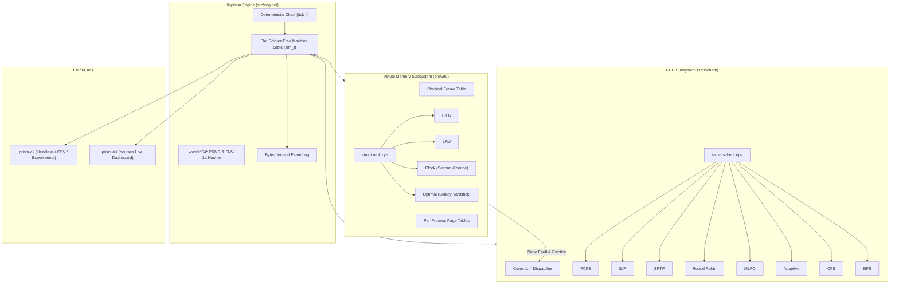

# PRISM: Process, Resource & Interprocess Simulation Model

A deterministic, high-fidelity Operating Systems simulation engine written in pure C11. PRISM models the critical interaction between **CPU scheduling** and **virtual memory page replacement** inside a single deterministic machine.

---

## Key Highlights & Architectural Decisions

1. **Flat, Pointer-Free State (`sim_t`)**:
   - The entire simulation machine state lives in a single, contiguous struct with fixed-capacity arrays.
   - Ready queues and page tables use 16-bit indices instead of pointers.
   - **Zero-cost Snapshot & Rewind**: Taking a snapshot of the entire machine is a single `memcpy` (`sim_snapshot`), enabling interactive rewind and replay during demos.

2. **Guaranteed Determinism**:
   - Uses an internal 64-bit `xorshift64*` PRNG rather than `rand()` from host libc.
   - Produces byte-identical event logs verified via 64-bit **FNV-1a log hashing**.
   - `Same workload + same seed + same policies = byte-identical event log hash`.

3. **Pluggable Policy Ops Tables**:
   - **Schedulers (`sched_ops_t`)**: 8 deterministic policies supported:
     - `FCFS`: First-Come First-Served.
     - `SJF`: Shortest Job First (non-preemptive).
     - `SRTF`: Shortest Remaining Time First (preemptive on arrival and wake).
     - `Round Robin`: Quantum-based timeslicing.
     - `MLFQ`: 3-level Multi-Level Feedback Queue with priority boosting.
     - `Adaptive`: Starvation aging + page-fault thrashing awareness.
     - `CFS`: Completely Fair Scheduler with virtual runtime (`vruntime`) tracking, latency granularity, and nice weighting.
     - `BFS`: Brainfuck Scheduler with single-runqueue earliest effective virtual deadline (`virtual_deadline`).
   - **Page Replacement (`repl_ops_t`)**: FIFO, LRU, Clock (second chance), and Optimal (Belady's OPT). Switchable at runtime.

4. **The Integration Loop**:
   - CPU burst accesses virtual page $\to$ page fault blocks process $\to$ disk services after $N$ ticks $\to$ frame allocated/evicted $\to$ process restored to `READY`.

5. **Frontends**:
   - `libprism.a`: Standalone C library with zero I/O or GUI dependencies.
   - `prism-cli`: Headless batch experiment runner, text Gantt chart generator, and CSV exporter.
   - `prism-tui`: Interactive `htop`-style ncurses dashboard with live frame allocation grid and fault injection.

---

## Architecture Diagram



---

## Directory Layout

```
.
├── Makefile                     # Release, debug, ASan/UBSan, valgrind targets
├── include/
│   └── prism/
│       ├── types.h              # Data types, event enums, limits
│       ├── prng.h               # Deterministic xorshift64* generator
│       ├── hash.h               # FNV-1a 64-bit log hasher
│       ├── pcb.h                # Process Control Block & Page Tables
│       ├── sched.h              # struct sched_ops interface
│       ├── vm.h                 # struct repl_ops interface & frame table
│       ├── sim.h                # Master flat sim_t state and engine API
│       └── workload.h           # Text workload parser & generators
├── src/
│   ├── engine/
│   │   ├── sim.c                # Engine tick loop, queues, fault injection
│   │   └── workload.c           # Workload file parser and synthetic builders
│   ├── sched/
│   │   └── schedulers.c         # FCFS, RR, MLFQ, Adaptive
│   ├── vm/
│   │   └── replacement.c        # FIFO, LRU, Clock, Optimal (Belady OPT)
│   ├── cli/
│   │   └── main.c               # Headless CLI & experiments runner
│   └── ui/
│       └── tui.c                # Interactive ncurses dashboard
├── tests/
│   ├── test_harness.h           # Assertion-based test suite macros
│   └── test_prism.c             # Determinism, rewind, Belady & textbook tests
└── workloads/
    ├── textbook_rr.txt          # Standard textbook scheduling scenario
    ├── classic_vm.txt           # Classic 7,0,1,2,0,3... page reference string
    ├── belady.txt               # Belady's anomaly reference string
    └── mixed_demo.txt           # Multi-core mixed CPU/IO/Memory workload
```

---

## Quickstart & Build Targets

```bash
# Standard release build (-O2 -Wall -Wextra -Wpedantic)
make

# Run automated assert-based unit tests
make test

# Run tests under AddressSanitizer & UndefinedBehaviorSanitizer
make sanitize

# Run Valgrind leak and memory cleanliness verification
make valgrind

# Run all 3 course project experiments & snapshot verification
make experiments
```

---

## Experiments & Academic Results

### Experiment 1: Scheduler Comparison on Mixed Workload
Compares FCFS, Round Robin, MLFQ, and Adaptive schedulers under a mixed workload (CPU-bound, interactive, I/O-bound processes):
```bash
./prism-cli --exp1
```
Output:
```
Scheduler    Avg Wait   Avg Turn   Avg Resp   Ctx Switches CPU Util %
----------------------------------------------------------------------
FCFS         79.17      119.50     1.67       88           98.1%
Round Robin  87.17      125.50     1.67       112          99.4%
MLFQ         72.17      104.17     1.67       81           99.3%
Adaptive     86.67      124.50     1.67       103          96.9%
```

### Experiment 2: Replacement vs. Frame Count & Belady's Anomaly
Runs FIFO, LRU, Clock, and Optimal against Belady's reference string `[1, 2, 3, 4, 1, 2, 5, 1, 2, 3, 4, 5]` and the classic reference string:
```bash
./prism-cli --exp2
```
Key verification:
- **Classic String (3 frames)**: FIFO = 15 faults, LRU = 12 faults, OPT = 9 faults.
- **Belady's Anomaly**: FIFO with 3 frames yields **9 faults**, while 4 frames yields **10 faults**!

### Experiment 3: RAM Shrinking, Thrashing & Adaptive Mitigation
Throttles available frames from 12 down to 6 and 3 frames to observe thrashing:
```bash
./prism-cli --exp3
```
- With **12 frames**: Working set fits in RAM $\to$ **12 cold faults**, total duration 138 ticks.
- With **6 and 3 frames**: Working set exceeds RAM $\to$ **100 faults**, total duration doubles to 248 ticks due to persistent disk stall bottlenecks.

### Step-Backward & Snapshot Determinism Verification
```bash
./prism-cli --rewind-demo
```
Demonstrates that a simulation can be snapshotted at tick 15, run to completion, restored, re-run to completion, and produce an identical FNV-1a 64-bit hash.

---

## Interactive Dashboard (`prism-tui`)

Launch the visual dashboard:
```bash
./prism-tui workloads/mixed_demo.txt
```

### Key Bindings
| Key | Action |
|-----|--------|
| `[SPACE]` | Play / Pause simulation |
| `[S]` | Single-step 1 tick forward |
| `[B]` | **Step backward / Rewind** to previous snapshot |
| `[M]` | Cycle CPU Scheduler (FCFS $\to$ RR $\to$ MLFQ $\to$ Adaptive) |
| `[P]` | Cycle Page Replacement Policy (FIFO $\to$ LRU $\to$ Clock $\to$ OPT) |
| `[K]` | **Fault Injection**: Kill currently selected process |
| `[D]` | **Fault Injection**: Shrink available RAM frames |
| `[UP] / [DOWN]` | Select process in process table |
| `[+] / [-]` | Increase / decrease simulation step delay |
| `[R]` | Reset simulation to tick 0 |
| `[Q]` | Quit dashboard |

---

## 6-Minute Demo Script

1. **Launch TUI with mixed workload**:
   Run `./prism-tui workloads/mixed_demo.txt`. Point out multi-core dispatch timeline, process state colors, and physical frame owners.
2. **Step through a page fault**:
   Press `[S]` tick-by-tick. Show a process requesting a page, transitioning to `BLOCK_VM`, the core switching to an unblocked process, the disk timer elapsing, the frame being populated, and the process returning to `READY`.
3. **Demonstrate Rewind**:
   Press `[B]` several times. Show the entire state machine (cores, frames, page tables, queues) stepping backwards seamlessly.
4. **Switch Policies Mid-Run**:
   Press `[M]` to switch schedulers (e.g. from RR to MLFQ) and `[P]` to switch replacement (e.g. FIFO to Optimal).
5. **Fault Injection & Thrashing**:
   Press `[D]` to dynamically shrink RAM frames mid-run and show page evictions exploding.
6. **Show Benchmark Experiments**:
   Exit to CLI and run `./prism-cli --all-exp`. Show the textbook comparison tables and Belady anomaly proof.
