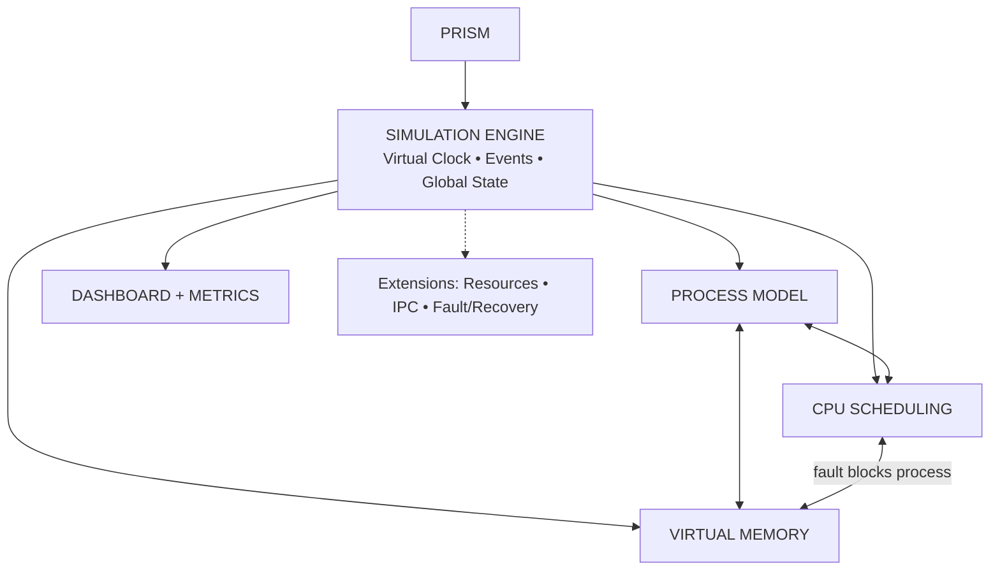

# PRISM Architecture

## 1. Scope

```
PRISM
 └── SIMULATION ENGINE  (virtual clock • event queue • global state)
      ├── PROCESS MODEL        lifecycle • states • bursts            [core]
      ├── CPU SCHEDULING       FCFS • SJF • SRTF • RR • Priority • MLFQ [core]
      ├── VIRTUAL MEMORY       paging • faults • FIFO/LRU/Clock/OPT   [core]
      ├── DASHBOARD + METRICS  TUI • headless • CSV                   [core]
      ├── RESOURCES + DEADLOCK                                        [extension]
      ├── IPC / SYNC                                                  [extension]
      └── FAULT INJECTION + CHECKPOINT/RESTORE                        [extension]
```

The key idea: **subsystems interact**. A memory access during a CPU burst can page-fault, which blocks the process, which makes the scheduler pick someone else. That coupling is what makes this a system model, not two separate assignments.



## 2. Module map

| File(s) | Responsibility |
|---|---|
| `event.c` | Min-heap keyed by `(time, seq)`. Deterministic ordering. |
| `process.c` | Burst advance, per-tick page reference generation (`seq`/`rand`/`local`/`trace`). |
| `workload.c` | Parse `.wl` files, seeded xorshift32 PRNG. |
| `sim.c` | Main loop, dispatch, blocking/unblocking, tracing. Glue only; no policy logic. |
| `sched.c` + `sched_*.c` | Registry + one file per policy behind `struct sched_ops`. |
| `vm.c` + `repl_*.c` | Page tables, frame table, `vm_access()`, one file per replacement policy behind `struct repl_ops`. |
| `metrics.c` | Aggregates, table + CSV output. |
| `ui_tui.c` | ncurses dashboard (Milestone 5). Reads `struct sim`, never mutates it except via `sim_step()`. |
| `main.c` | CLI parsing only. |

Headers in `include/` are the **contracts**. Implement against them; change them deliberately and note it in `CLAUDE.md`'s decision log.

## 3. Simulation model

**Time** is discrete `tick_t`. One CPU tick = one unit of work and **one memory reference** for the running process.

**Process** = list of bursts (`cpu N` / `io N`) + a page-reference generator over `pages` virtual pages.

**States:** `NEW → READY → RUNNING → {READY | BLOCKED_IO | BLOCKED_FAULT | TERMINATED}`. `BLOCKED_* → READY`.

### Main loop (`sim_step`)
```
pop earliest event (time, seq); advance now = event.time
switch event.type:
  ARRIVAL:     vm_add_process; state=READY; sched.enqueue; maybe preempt running
  TICK:        running process issues one reference -> vm_access
                 HIT:   continue; decrement burst_left; schedule next TICK or BURST_END
                 FAULT: state=BLOCKED_FAULT; schedule FAULT_DONE at now+fault_service; dispatch next
  BURST_END:   next burst is IO -> BLOCKED_IO + schedule IO_DONE; no more bursts -> TERMINATED
  QUANTUM_END: if gen matches: on_quantum_expired; enqueue running; dispatch next
  IO_DONE / FAULT_DONE: state=READY; enqueue; maybe preempt
dispatch(): pick_next; if none -> idle until next event; else RUNNING, schedule TICK and QUANTUM_END (gen-stamped)
```
Stale events (quantum for a process that already blocked/preempted) are detected by `gen` and dropped. Bump `pcb.gen` whenever a process leaves the CPU.

**Context switch cost:** `ctx_switch` ticks of non-productive time on every dispatch where `pid != last_pid`. Counted in `ctx_switches`, not in `busy`.

**Fault timing:** the faulting reference completes after `fault_service` ticks; when the process resumes, that page is resident and the reference is not re-issued (it already counted as a fault).

## 4. CPU scheduling

| Policy | Preemptive | Notes |
|---|---|---|
| `fcfs` | no | FIFO queue |
| `sjf` | no | key = next CPU burst (use `remaining_cpu` of the current burst), tie → arrival |
| `srtf` | on arrival/wake | `should_preempt` if candidate remaining < running remaining |
| `rr` | quantum | `--quantum N` |
| `prio` | on arrival/wake | lower number wins; **aging**: +1 priority every K ticks waiting |
| `mlfq` | quantum per level | 3 levels, quanta 4/8/16 (configurable), demote on expiry, boost every B ticks |

Starvation demo: a priority workload without aging vs. with aging.

## 5. Virtual memory

- Per-process page table `pte[num_pages]`; global frame table of `nframes`.
- **Demand paging**: pages load on first touch. Free frame first, otherwise `repl->choose_victim`.
- **Global replacement** (victim can belong to another process). Local replacement is an optional extension.
- Policies: `fifo`, `lru` (use `last_used`), `clock` (second chance with ref bits), `opt` (Belady, offline: precompute the full reference string in a pre-pass, used only as a lower bound for comparison).
- `vm_access` returns `VM_HIT`, `VM_FAULT_FREE`, or `VM_FAULT_EVICT` plus evicted `(pid,page)` so the dashboard can animate evictions.
- **Thrashing detection:** if fault rate over the last W accesses exceeds a threshold, flag it on the dashboard. Optional mitigation (extension): suspend a process.
- On exit, free all frames of the process via `vm_remove_process`.

**OPT in a multi-process run** needs the exact interleaving of references, which depends on scheduling. Approach: run the simulation once with a recording policy (FIFO) to capture the reference string, then rerun with OPT using that string. Document this limitation; it is exact for single-process workloads (Belady test).

## 6. Workload format (`.wl`)

```
# comment
config frames=8 fault_service=5 ctx_switch=0 seed=1

proc P1 arrival=0 priority=2 pages=6 refs=local ws=3     # refs: seq | rand | local | trace
  cpu 8
  io 4
  cpu 6
end

proc B arrival=0 priority=1 pages=5 refs=trace
  reftrace 1 2 3 4 1 2 5 1 2 3 4 5
  cpu 12
end
```
Rules: `#` comments; `config` once, optional (defaults: frames=8, fault_service=5, ctx_switch=0, seed=1); one process per `proc … end`; bursts alternate freely but the first must be `cpu`; `ws` only with `refs=local`; `reftrace` only with `refs=trace`. Errors print `file:line: message`. `pid` = order of definition.

`refs=local`: 90% of references fall in a hot set of `ws` pages, 10% anywhere (PRNG-driven).

## 7. Outputs

- **Headless table:** per-process turnaround/waiting/response/faults, then aggregate metrics.
- **Gantt:** one line of text per scheduling change, plus a compact ASCII Gantt strip.
- **CSV (`--csv`):** one row per (sched, repl, frames) for plotting comparisons.
- **Dashboard (TUI):** four panels — ready queue + running process; Gantt strip; frame table grid (each cell `pid:page`, evicted cells flash); live metrics. Keys: `space` step, `r` run/pause, `+/-` speed, `s` cycle scheduler, `p` cycle replacement, `q` quit.

Metric definitions: turnaround = finish − arrival; waiting = turnaround − cpu_time − io_time − fault-blocked time (state this in the report); response = first_run − arrival; CPU util = busy / makespan; fault rate = faults / accesses.

## 8. Test strategy

| Test | What it proves |
|---|---|
| `test_event` | heap ordering, tie-breaking by seq |
| `test_workload` | parsing, error messages |
| `test_sched` | textbook examples: hand-computed avg waiting/turnaround for FCFS, SJF, SRTF, RR(q=4) |
| `test_vm` | FIFO/LRU/OPT fault counts on known strings; **Belady's anomaly** (FIFO: 3 frames → 9 faults, 4 frames → 10) |
| `test_integration` | deterministic: same input twice → byte-identical output; faults block and scheduler switches |
| `make debug` | no ASan/UBSan errors or leaks |

## 9. Extensions (only after core is done)
Resource manager + deadlock detection (wait-for graph / Banker's) • IPC (message queues, semaphores) • fault injection • checkpoint/restore of `struct sim` • TLB model • local replacement • HTML trace viewer (only if a non-C viewer is acceptable to the teacher).
